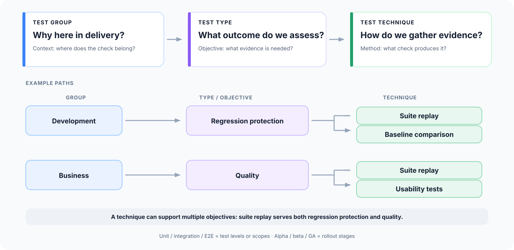
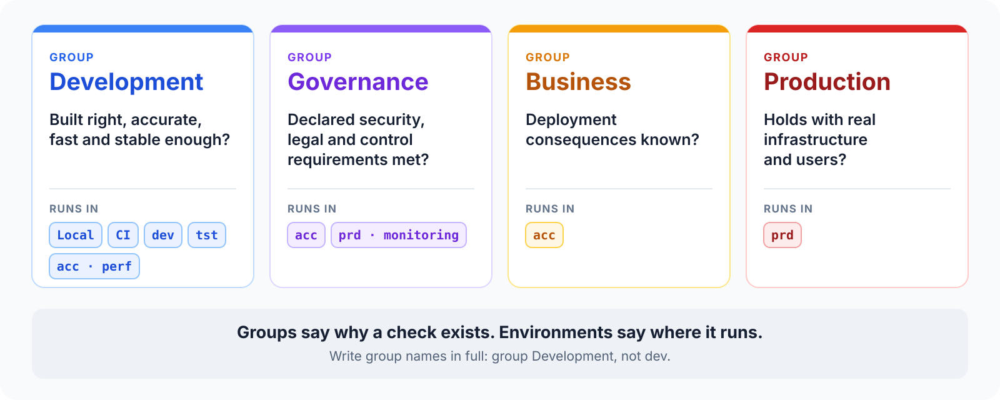
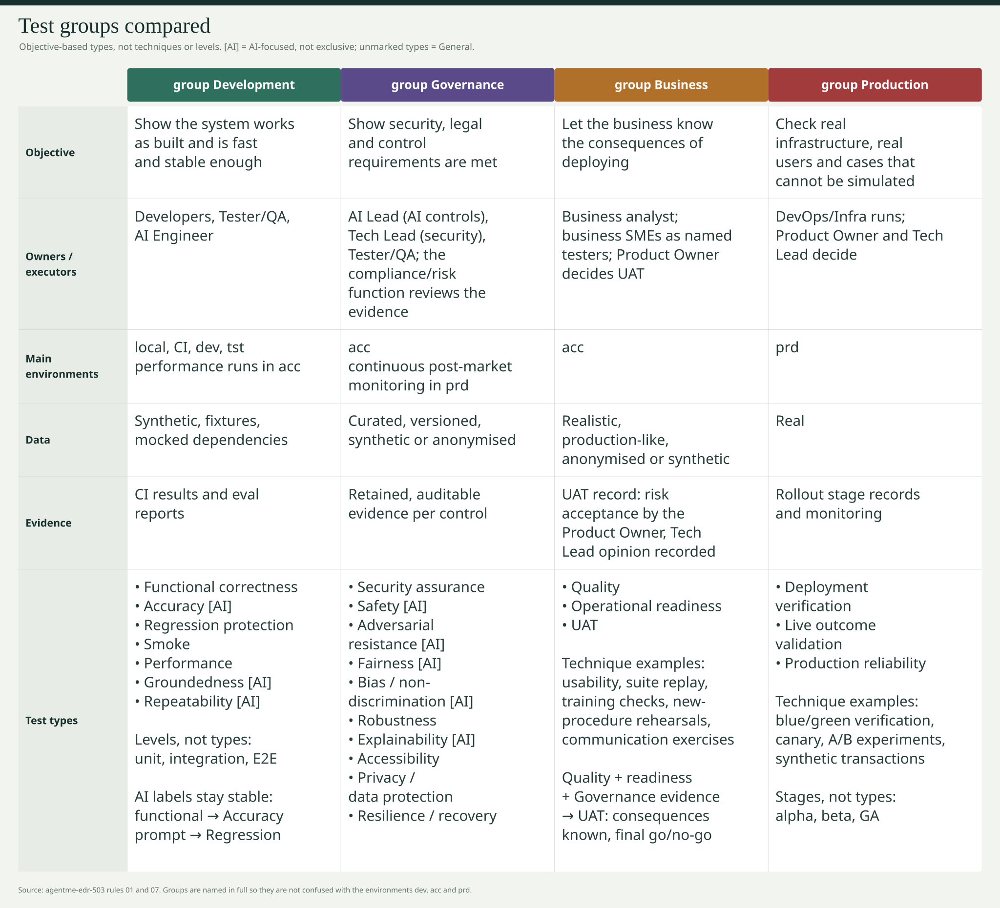
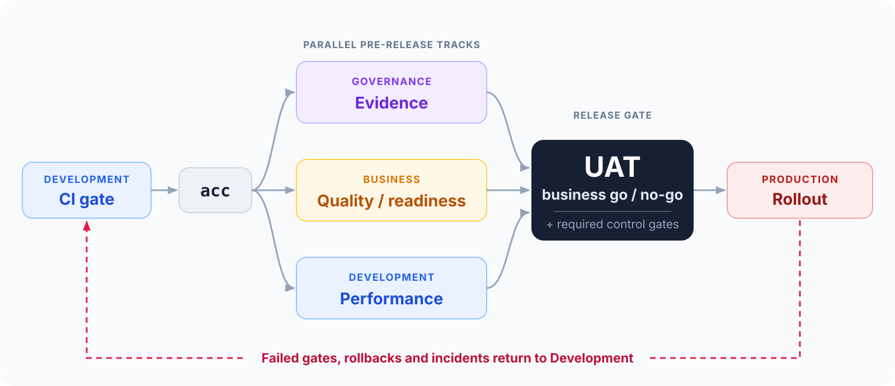
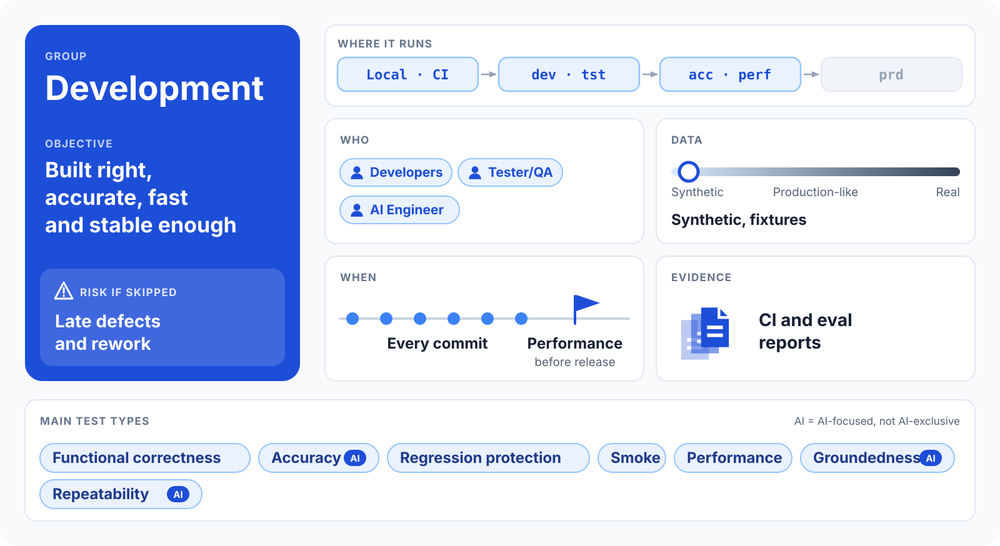
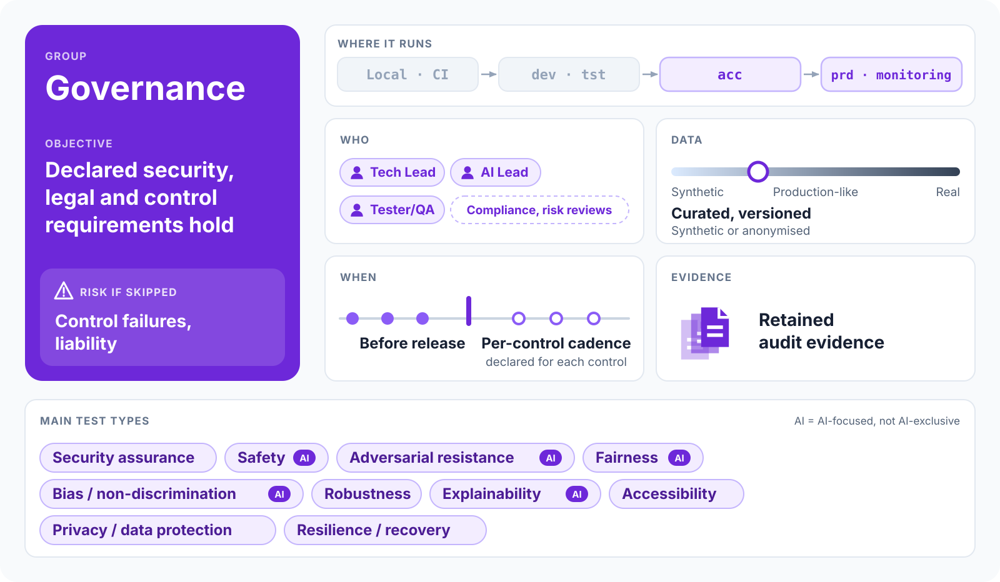
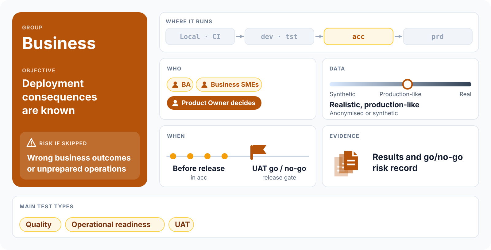
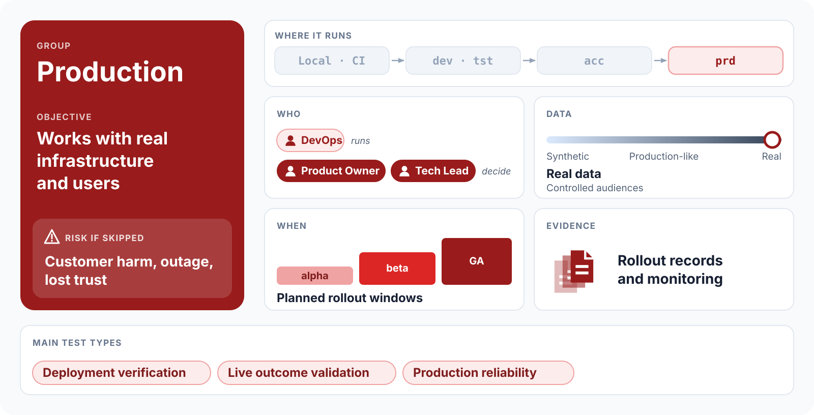
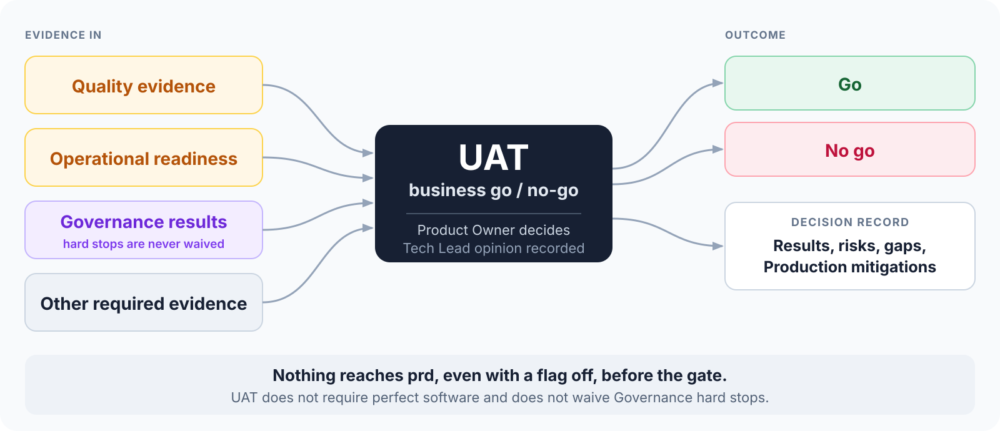
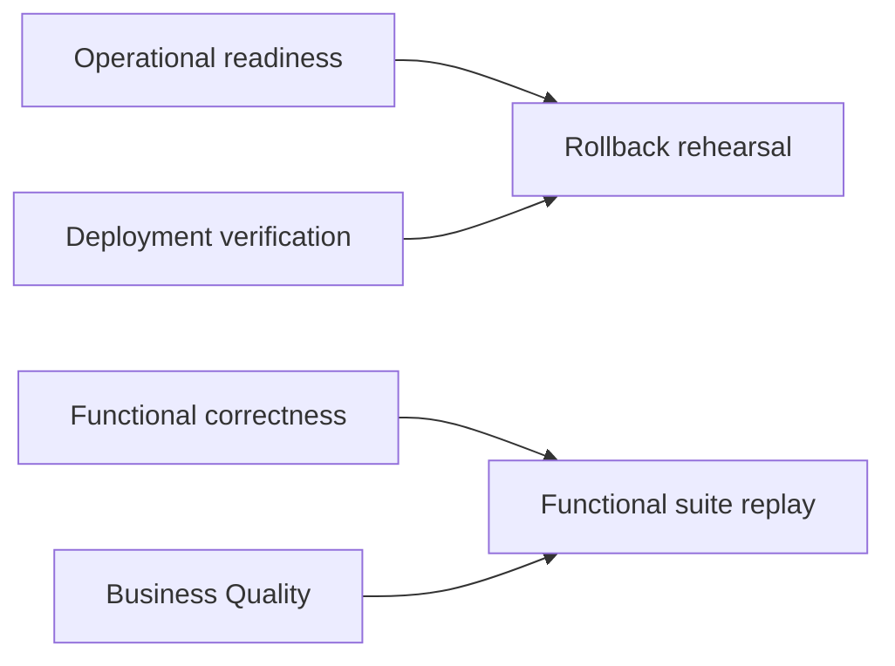

# Software and AI testing requirements

## From code assertions to statistical evals and release evidence

Audience: traditional software and AI engineers

---

## Three different questions



---

## Four groups, not four environments



---

## Four groups: shared reference



---

## From commit to production



---

<style scoped>
section { padding: 18px 28px; }
h2 { margin: 0 0 6px; font-size: 1.15em; }
img { display: block; margin: 0 auto; }
</style>

## group Development



---

<style scoped>
section { padding: 18px 28px; }
h2 { margin: 0 0 6px; font-size: 1.15em; }
img { display: block; margin: 0 auto; }
</style>

## group Governance



---

<style scoped>
section { padding: 18px 28px; }
h2 { margin: 0 0 6px; font-size: 1.15em; }
img { display: block; margin: 0 auto; }
</style>

## group Business



---

<style scoped>
section { padding: 18px 28px; }
h2 { margin: 0 0 6px; font-size: 1.15em; }
img { display: block; margin: 0 auto; }
</style>

## group Production



---

## Development objectives

| Type | Example technique |
|---|---|
| Functional correctness | Assertions, contract checks |
| Accuracy [AI] | Representative datasets, task rubrics |
| Regression protection | Suite replay, baseline comparison |
| Smoke | Critical-scenario subset |
| Performance | Baseline, load, stress, spike, soak |
| Groundedness [AI] | Claim-to-context checks |
| Repeatability [AI] | Repeated-run semantic comparison |

**[AI] = AI-focused**, not AI-exclusive. Unmarked types are General.

---

## Governance objectives (1/2)

| Type | Example technique |
|---|---|
| Security assurance | Penetration testing, DAST |
| Safety [AI] | Policy scenarios, red teaming |
| Adversarial resistance [AI] | Injection/jailbreak exercises |
| Fairness [AI] | Segment scenarios |
| Bias / non-discrimination [AI] | Paired counterfactual checks |

Methods are options, not mandatory or exclusive implementations.

---

## Governance objectives (2/2)

| Type | Example technique |
|---|---|
| Robustness | Perturbation, boundary checks |
| Explainability [AI] | Rationale review, fidelity checks |
| Accessibility | Keyboard, screen-reader, automated checks |
| Privacy / data protection | Access and retention checks |
| Resilience / recovery | Failover and restore drills |

Governance purpose requires control-based criteria and retained audit evidence.

---

## Business Quality

**Objective:** fitness for intended business use against agreed functional and user-experience requirements.

Techniques:

- Usability tests: observed task completion, think-aloud.
- Functional-requirement suite replay.
- Business-scenario walkthroughs.

An easy-to-use checkout can still calculate the wrong amount.

Provide results against agreed requirements, not only a green CI badge.

---

## Operational readiness includes business operations

**Objective:** people and capabilities can operate the changed service.

Techniques:

- Training-effectiveness checks.
- New business-procedure rehearsals.
- Communication exercises.
- Rollback rehearsal and incident simulation.
- Runbook exercise and alert verification.

Attendance is not capability. Sending a message is not proof it was understood.

Technical rollback success does not prove a business procedure works.

---

## UAT: ultimate business go/no-go

User Acceptance Testing (**UAT**) establishes whether deployment consequences are known.



---

## Production objectives

| Type | Example techniques |
|---|---|
| Deployment verification | Blue/green checks, canary, post-deploy smoke, shadow comparisons |
| Live outcome validation | A/B experimentation |
| Production reliability | Synthetic transactions, service-level checks |

Blue/green deployment alone is not a test.

A/B can conclude A wins, B wins, or inconclusive: the objective is a defensible decision.

---

## Reusable techniques, different objectives



The purpose, criteria and evidence distinguish the tests.

Changing the method does not rename the objective.

---

## AI Accuracy is not code correctness

| Objective | Question |
|---|---|
| Functional correctness | Do logic, interfaces and invariants hold? |
| Accuracy [AI] | Do model outputs meet task-quality criteria reliably? |
| Repeatability [AI] | Are equivalent requests consistent? |

AI-assisted invoice example:

- Unit tests: fake-model parsing, authorization and routing.
- Accuracy: real-model invoices scored against fields or rubrics.
- Repeatability: compare equivalent repeated requests.

Schema validity alone does not establish correct values.

---

## Accuracy needs statistical evidence

- Representative inputs and important scenario slices.
- Dependable expected outcomes or rubrics.
- Suitable, checked scoring methods.
- Stochastic variation and uncertainty.
- Existing confidence intervals and convergence reports.

A large dataset is not automatically representative.
Repeating a few inputs does not cover more distinct scenarios.

No universal minimum sample count is introduced.

Existing `functional` eval labels map to **Accuracy**; interfaces stay unchanged.

---

## Separate offline checks from live evals

| Target | Execution boundary |
|---|---|
| `make lint`, `make test` | Offline; no credentials, paid models or live servers |
| `make eval` | Opt-in live-model evaluation |
| `make eval-functional` | Accuracy cases in an eval folder |
| `make eval-prompt` | Prompt/model regression cases |
| `make test-performance-<kind>` | Deployed target; explicit address and `STAGE` |

Live eval and performance targets do not belong in `test` or `all`.

---

## AI suites own datasets and scoring

Illustrative project commands, not targets in this documentation repository:

```sh
make lint
make test
make -C evals/workflow-invoice/eval-basic eval-smoke
make -C evals/workflow-invoice/eval-basic eval-functional
```

Each eval folder owns:

- `eval.py` and its Makefile.
- `golden_dataset/`: README, schema, per-case JSON.
- Thresholded reports.

Evaluate Workflow, Agent and LLM components with independent datasets.

---

## Test performance outside the process

- Use a separate `performance-<slug>/` module.
- Drive the deployed system, not just an in-process benchmark.
- Declare thresholds before the run.
- Check persisted-data integrity, not only latency and throughput.
- List differences between `acc` and `prd`.
- Retain results and report files.

Golden-dataset `eval.py` does not run performance scenarios.

---

## The tier decides mandatory proof

| Tier | Unit tests | Evals | Integration |
|---|---|---|---|
| LLM | Not required | Recommended for critical prompts | Not required |
| Agent | Not required | Optional | Not required |
| Workflow | Mandatory; 80% code and graph-edge/branch coverage | Before release; failures block | Recommended |

The catalogue itself adds no mandatory suites.

Tier requirements and A/B triggers remain in agentme-edr-501.

---

## Cheap signals before expensive ones

Advisory progression, not another release gate:

1. Code-level unit/integration checks.
2. Smoke.
3. Accuracy / Regression protection.
4. Deeper safety, adversarial, fairness, bias and other checks.

Evals call the **real model** and follow existing surrounding-dependency mocking rules.

Failing required tests and eval thresholds still block release.

---

## Engineer's release checklist

- Trace each change to objectives and measurable criteria.
- Keep code checks, model evals and deployed-system tests distinct.
- Retain results, control evidence and operational rehearsals.
- Make gaps and residual risk explicit for UAT.
- Verify routing, guardrails and rollback during rollout.
- Turn incidents and escaped defects into regression cases.

One scenario can serve multiple objectives; a green suite is not the whole release decision.

---

# References

- [Article: AI system testing requirements](../002-ai-system-testing-requirements.md)
- [503: Groups, objectives, techniques and UAT](../../../../../agentme/edrs/governance/503-test-groups-and-release-flow.md)
- [152: AI labels and Accuracy methods](../../../../../agentme/edrs/application/152-ai-test-types-taxonomy.md)
- [501: Mandatory testing requirements](../../../../../agentme/edrs/governance/501-project-quality-standards.md)
- [303: Execution targets](../../../../../agentme/edrs/platform/303-common-targets.md)
- [151: Eval layout and targets](../../../../../agentme/edrs/application/151-ai-eval-standards.md)
- [306: Deployed-system performance tests](../../../../../agentme/edrs/platform/306-performance-testing.md)
