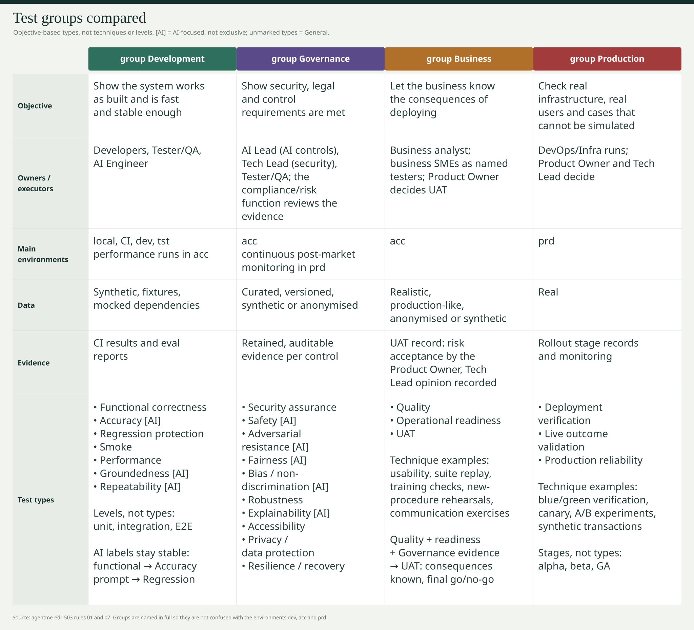

# _local-edr-article-002: ai-system-testing-requirements

## Overview

For traditional software and AI engineers: design test suites around objectives, separate offline checks from live evaluation, measure stochastic accuracy, and deliver reproducible evidence for release gates and production rollout.

## Content

### Design suites around objectives, not tools

Passing unit tests, replaying model evaluations and verifying a deployment establish different things. Start with the objective, then choose the scope, technique and execution environment. [agentme-edr-503](../../../../agentme/edrs/governance/503-test-groups-and-release-flow.md) separates:

```text
Test Group ------> Test Type ----------------> Test Technique
Why here in        What outcome or             How can we gather
delivery?          assurance do we assess?      that evidence?

group Development -> Regression protection -> Suite replay
                                          +-> Baseline comparison

group Business ----> Quality ---------------> Suite replay
                                          +-> Usability tests
```

Replaying checkout tests in CI protects behavior; replaying agreed business scenarios in `acc` supports Quality. The method is shared, but the criteria and evidence serve different decisions. Blue/green verification serves Deployment verification; penetration testing serves Security assurance. Neither technique defines the objective.

Unit, integration and E2E describe **levels/scopes**. Alpha, beta and GA describe **rollout stages**. Neither is an objective type. A group is not an environment: use the full name, such as "group Governance", to avoid confusion with `dev`, `acc` and `prd`.

### Put evidence on the delivery path

| Group | Question | People and evidence | Main environment |
|---|---|---|---|
| Development | Is it built right, accurate, fast and stable enough? | Developers, Tester/QA, AI Engineer; CI and eval reports | Local, CI, `dev`, `tst`; performance in `acc` |
| Governance | Do declared security, legal and control requirements hold? | Tech Lead, AI Lead, Tester/QA; compliance/risk reviews retained control evidence | `acc`; post-market monitoring in `prd` |
| Business | Do we know the consequences of deploying? | BA and business SMEs supply evidence; Product Owner decides UAT, Tech Lead opinion recorded | `acc` |
| Production | Does it hold with real infrastructure and users? | DevOps runs; Product Owner decides stage moves, Tech Lead owns rollback; rollout records | `prd` |



The release flow in [503](../../../../agentme/edrs/governance/503-test-groups-and-release-flow.md#02-flow-and-gates) keeps three parallel pre-release tracks:

```text
group Development CI gate --> deploy to acc
                                  |
                +-----------------+-----------------+
                v                 v                 v
        group Governance   group Business     group Development
          control evidence  Quality/readiness   performance
                |                 |                 |
                +-----------------+-----------------+
                                  v
                    UAT business go/no-go
                    + required control gates
                                  |
                                  v
                    group Production: alpha -> beta -> GA
```

Failed gates, defects, rollbacks and incidents return to Development. Nothing reaches `prd`, even with a flag off, before the business gate. Business cannot waive failed Governance controls; only compliance/risk can record eligible exceptions, and hard stops remain non-waivable. The emergency path records reduced scope, approval, risk and a due date for each skipped test; it is not a silent bypass. See [503's gate and exception rules](../../../../agentme/edrs/governance/503-test-groups-and-release-flow.md#03-governance-exceptions).

### The objective catalogue

These are short views of [503's authoritative catalogue](../../../../agentme/edrs/governance/503-test-groups-and-release-flow.md#07-every-test-type-has-one-main-group), not additional requirements. **AI-focused** means strong affinity, not exclusivity; unmarked types are **General**, including when used on AI systems. Methods are examples, not mandatory or exhaustive lists.

| Group | Type | Outcome assessed | Common techniques |
|---|---|---|---|
| Development | Functional correctness | Required logic and contracts work | Scenario assertions, contract checks |
| Development | Accuracy (AI-focused) | Model task quality holds across representative inputs, with uncertainty considered | Golden datasets, task rubrics, statistical evaluation |
| Development | Regression protection | Changes preserve required behavior | Suite replay, baseline comparison |
| Development | Smoke | Essential behavior works before proceeding | Critical-scenario subset |
| Development | Performance | Speed, capacity and resource limits hold | Baseline, load, stress, spike, soak |
| Development | Groundedness (AI-focused) | Claims have source support | Claim-to-context checks |
| Development | Repeatability (AI-focused) | Equivalent requests remain sufficiently consistent | Repeated-run semantic comparison |
| Governance | Security assurance | Declared security controls hold | Penetration testing, DAST |
| Governance | Safety (AI-focused) | Harmful-output/action constraints hold | Policy scenarios, red teaming |
| Governance | Adversarial resistance (AI-focused) | Malicious input cannot bypass controls | Injection/jailbreak exercises |
| Governance | Fairness (AI-focused) | Legitimate segments get intended outcomes | Segment scenarios |
| Governance | Bias / non-discrimination (AI-focused) | Protected attributes do not cause prohibited differences | Paired counterfactual checks |
| Governance | Robustness | Variable input preserves required behavior | Perturbation, boundary checks |
| Governance | Explainability (AI-focused) | Rationale faithfully supports outcomes | Rationale review, fidelity checks |
| Governance | Accessibility | People with disabilities can use required functions | Keyboard, screen-reader, automated checks |
| Governance | Privacy / data protection | Processing/access controls hold | Access and retention checks |
| Governance | Resilience / recovery | Continuity/recovery controls hold | Failover and restore drills |
| Business | Quality | Product fits business functional and user-experience requirements | Usability tests, functional-requirement suite replay |
| Business | Operational readiness | Business and technical operations can run the change | Training checks, procedure/communication exercises, rollback/runbook rehearsals |
| Business | UAT | Business knows deployment consequences and decides go/no-go | Evidence review, risk-impact walkthrough, sign-off |
| Production | Deployment verification | Deployment, routing and rollback work | Blue/green checks, canary, post-deploy smoke, shadow comparisons |
| Production | Live outcome validation | Real outcomes support version selection | A/B experimentation |
| Production | Production reliability | Service behavior holds in real operation | Synthetic transactions, service-level checks |

Governance is the primary group only for the control purpose and retained audit evidence defined in [503](../../../../agentme/edrs/governance/503-test-groups-and-release-flow.md#01-four-groups-follow-the-delivery-flow). Developers can run accessibility or safety checks in CI; usability with beta users supplies Production evidence. The objective and purpose matter, not just where the tool ran.

### Engineering evidence is input to UAT, not a substitute

**Quality** assesses business fitness through usability tests and functional-requirement suite replay. Provide results against agreed requirements, not only a green CI badge: an easy-to-use checkout can still calculate the wrong amount.

**Operational readiness** combines technical and business capabilities. Exercise rollback, alerts and runbooks, but also rehearse new business procedures, verify operator capability after training, and check communication is understood. Training attendance and working alerts do not prove business operators can process the changed workflow.

**User Acceptance Testing (UAT)** is the final business go/no-go on known deployment consequences, as defined in [503](../../../../agentme/edrs/governance/503-test-groups-and-release-flow.md#04-business-gate-is-recorded-risk-acceptance), with authority from [BDR 405](../../../../agentme/bdrs/operations/405-digital-product-roles-raci.md).

```text
Quality evidence ---------------+
Operational readiness evidence -+--> UAT: consequences known?
Governance results -------------+      |
Other required evidence --------+      +--> no-go: address gaps
                                       +--> go: enter Production
                                            subject to required controls
```

UAT records results, residual risks, untested areas and their Production mitigations. It does not demand perfect software, equate missing evidence with success, or waive a hard stop. A data-migration rehearsal can inform both Quality and readiness; UAT considers its business consequences.

### Why AI Accuracy is different from functional correctness

[152's AI Accuracy guidance](../../../../agentme/edrs/application/152-ai-test-types-taxonomy.md#12-accuracy-needs-statistical-evidence) distinguishes three outcomes:

- **Functional correctness:** code paths, interfaces and invariants hold.
- **Accuracy:** stochastic model outputs meet task-quality criteria across representative inputs, with uncertainty considered.
- **Repeatability:** equivalent repeated requests produce sufficiently consistent outputs.

For an AI-assisted invoice service, unit tests can validate parsing, tool authorization and routing with a fake model. Accuracy needs real-model invoice cases scored against expected fields or a task rubric. Repeatability checks equivalent requests across repeated invocations. A model can be consistently wrong, or give varied but equally correct answers; a schema-valid response is not evidence that its values are correct.

A large dataset is not automatically representative. Repeating a few inputs does not cover more distinct user scenarios. [154](../../../../agentme/edrs/application/154-ai-eval-report-format.md) already specifies confidence intervals and convergence reporting; projects retain their own thresholds and sample-sufficiency rationale, with no universal sample minimum introduced here.

The objective vocabulary does not rename execution interfaces: `functional` still selects Accuracy and `prompt` selects Regression protection. [152](../../../../agentme/edrs/application/152-ai-test-types-taxonomy.md#05-test-type-taxonomy) maps all eleven labels. Its golden-dataset evals use real LLM calls and mocked surrounding dependencies; unit tests remain offline. Evaluate component scopes independently: an end-to-end workflow result does not diagnose a particular agent or prompt.

### Wire execution boundaries explicitly

[303](../../../../agentme/edrs/platform/303-common-targets.md) separates offline developer checks from opt-in targets with live dependencies:

| Execution surface | Purpose | Boundary |
|---|---|---|
| `make lint`, `make test` | Static checks and offline tests | No credentials, paid models or live servers |
| `make eval` | All configured AI evals | Explicit live-model execution; not part of `test` or `all` |
| `make eval-functional` | Accuracy cases in an eval folder | Stable label; not generic unit testing |
| `make eval-prompt` | Prompt/model regression cases | Replay required behavior |
| `make test-performance-<kind>` | Deployed-system scenarios | Explicit `STAGE` and target address |

In an illustrative project following [151's layout](../../../../agentme/edrs/application/151-ai-eval-standards.md#01-eval-folder-structure):

```sh
make lint
make test
make -C evals/workflow-invoice/eval-basic eval-smoke
make -C evals/workflow-invoice/eval-basic eval-functional
```

These are project-interface examples, not commands supplied by this documentation repository. Each eval folder owns `eval.py`, a Makefile and `golden_dataset/` with README, schema and per-case JSON. Dataset `test_types` may label one case for several objectives without requiring another model call for each label; [153](../../../../agentme/edrs/application/153-ai-eval-script.md) defines execution, scoring and non-zero exits for failed thresholds.

For performance, use a separate `performance-<slug>/` module rather than an in-process benchmark or golden-dataset eval. [306](../../../../agentme/edrs/platform/306-performance-testing.md) defines declared thresholds, reports and integrity checks; list differences between `acc` and `prd` when interpreting results.

### What is mandatory, and what runs first?

[501](../../../../agentme/edrs/governance/501-project-quality-standards.md#09-ai-project-testing-requirements) owns the AI-tier requirements:

| Tier | Unit tests | Evals | Integration |
|---|---|---|---|
| LLM | Not required | Recommended for critical prompts | Not required |
| Agent | Not required | Optional | Not required |
| Workflow | Mandatory; 80% code coverage and graph-edge/branch coverage | Before every release; failing thresholds block release | Recommended |

The catalogue itself adds no mandatory suites. [152's progression](../../../../agentme/edrs/application/152-ai-test-types-taxonomy.md#11-test-quality-progression) advises cheap code checks, Smoke, then Accuracy/Regression protection before deeper checks; its ordering is guidance, not a new release gate.

[306](../../../../agentme/edrs/platform/306-performance-testing.md#04-environments-and-prod-guardrails) keeps stress, spike and resilience fault exercises out of `prd`. Technique examples do not override environment safeguards.

### Close the loop with production evidence

A/B experimentation serves **Live outcome validation**. [407](../../../../agentme/edrs/operations/407-a-b-testing-in-production.md) defines the experiment plan, random sticky assignment, guardrails, rollback and cleanup; [157](../../../../agentme/edrs/application/157-ai-a-b-testing.md) adds AI requirements. A legitimate result is A wins, B wins, or inconclusive: success is a defensible decision, not a promise that B wins. [501](../../../../agentme/edrs/governance/501-project-quality-standards.md#09-ai-project-testing-requirements) still decides when A/B is mandatory.

For each change, trace requirements to objectives, criteria, suite results and remaining gaps. Deliver retained control evidence and operational rehearsal results to UAT, not just test counts. During rollout, verify routing and rollback, watch declared service limits, and send incidents and escaped defects back into regression coverage. Checkout replay supports Development correctness and Business Quality; UAT uses its results to assess deployment consequences.

## References

- [Presentation slides](.assets/002-ai-system-testing-requirements-slides.md) - Four groups, objective types, techniques, AI Accuracy and UAT.
- [Three testing dimensions diagram](.assets/002-three-testing-dimensions.svg) - Visual distinction between test group, type, and technique.
- [Four groups vs environments diagram](.assets/002-four-groups-vs-environments.svg) - Each group's question and where it runs.
- [Commit to production flow diagram](.assets/002-commit-to-production-flow.svg) - Parallel tracks, UAT gate and feedback loop.
- [UAT go/no-go diagram](.assets/002-uat-go-no-go.svg) - Evidence feeding the UAT decision and its outcome.
- [group Development profile](.assets/002-group-development.svg) - Objective, environments, people, data, timing, evidence and risk.
- [group Governance profile](.assets/002-group-governance.svg) - Objective, environments, people, data, timing, evidence and risk.
- [group Business profile](.assets/002-group-business.svg) - Objective, environments, people, data, types, evidence and risk.
- [group Production profile](.assets/002-group-production.svg) - Objective, environments, people, data, timing, evidence and risk.
- [503: Test groups and release flow](../../../../agentme/edrs/governance/503-test-groups-and-release-flow.md) - Canonical catalogue and release gates.
- [152: AI test types taxonomy](../../../../agentme/edrs/application/152-ai-test-types-taxonomy.md) - AI execution mappings, datasets and Accuracy guidance.
- [154: AI eval report format](../../../../agentme/edrs/application/154-ai-eval-report-format.md) - Statistical reporting.
- [151: AI eval standards](../../../../agentme/edrs/application/151-ai-eval-standards.md) - Eval layout and Makefile targets.
- [153: AI eval script](../../../../agentme/edrs/application/153-ai-eval-script.md) - Case execution, scoring and threshold enforcement.
- [303: Common targets](../../../../agentme/edrs/platform/303-common-targets.md) - Offline and live execution boundaries.
- [501: Project quality standards](../../../../agentme/edrs/governance/501-project-quality-standards.md) - Mandatory tier testing and A/B triggers.
- [405: Digital product roles RACI](../../../../agentme/bdrs/operations/405-digital-product-roles-raci.md) - Go-live decision authority.
