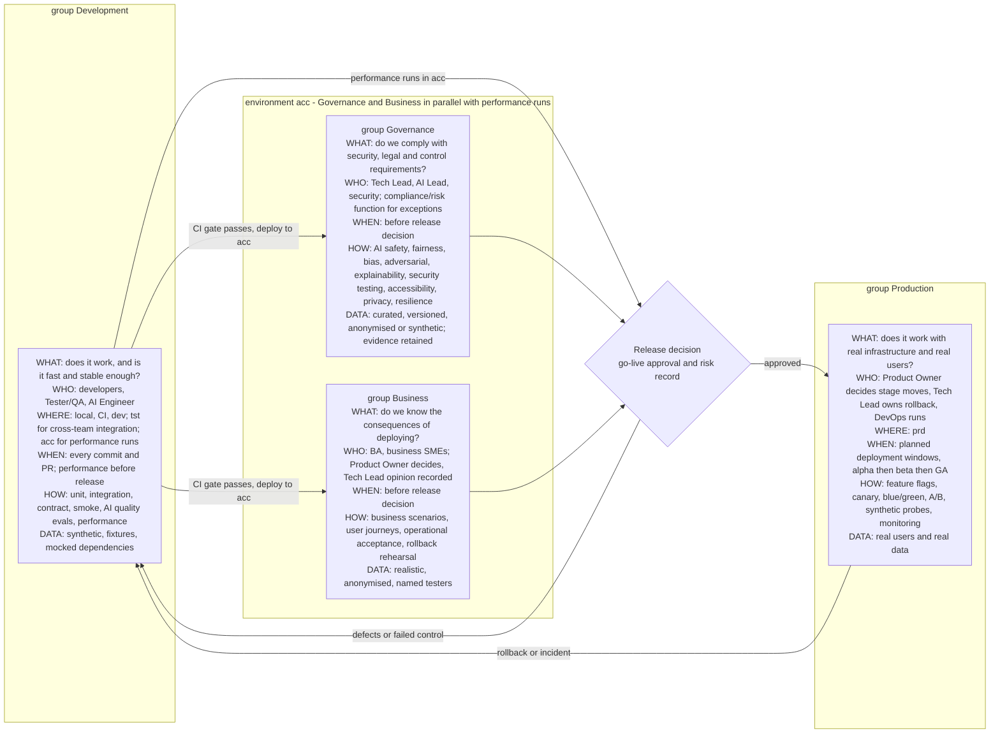
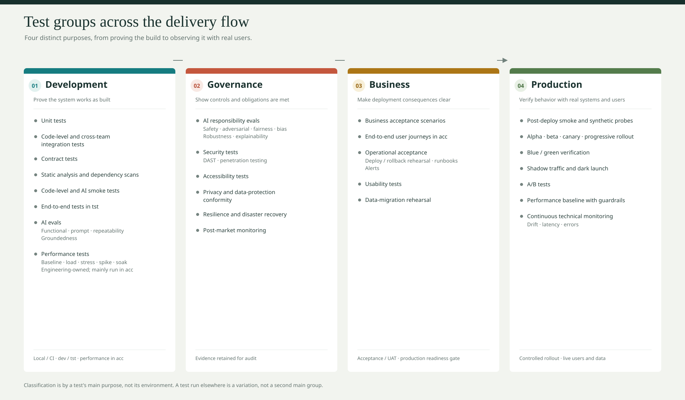
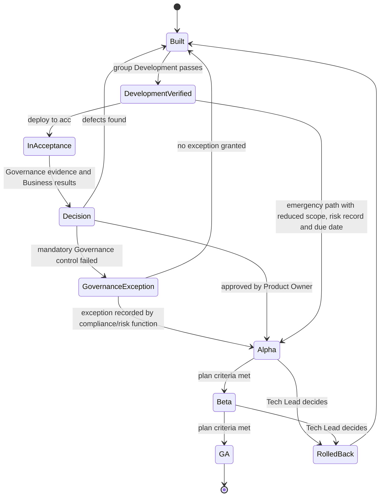

# _local-edr-article-002: ai-system-testing-requirements

## Overview

Explains why AI systems (LLM, Agent, Workflow tiers) need testing beyond regular code checks, the four test groups (Development, Governance, Business, Production) and how they flow to production, what's required per tier, what each test type verifies, and why failing tests block a release. Audience: business analysts defining AI requirements.

## Content

### Four groups of tests, four different conversations

"We tested it" can mean four unrelated things, with different risk, people, data and standards. [agentme-edr-503](https://github.com/flaviostutz/agentme/tree/main/.xdrs/agentme/edrs/governance/503-test-groups-and-release-flow.md) sorts every test type into a group by what the test is for at that point of the delivery flow, not by where it runs. Groups are always written in full ("group Governance") so they are not mixed up with the `dev`, `acc` and `prd` environments.

The catalog below shows each test type's main group. A technique used elsewhere is a variation, not a second main classification.

Governance and Business run side by side in `acc` and feed one release decision. A failed Governance control cannot be waived by the business approver; only the organisation's compliance/risk function can record an exception, and requirements that [agentme-edr-501](https://github.com/flaviostutz/agentme/tree/main/.xdrs/agentme/edrs/governance/501-project-quality-standards.md) rule `09` makes a hard stop are never waived. The Business gate does not claim the software is perfect: it records what was not tested in `acc` (for example, because simulating it is too costly or impossible) and how group Production mitigates it with a slow rollout, feature flags and monitoring. Nothing reaches `prd`, even with a flag off, before that gate.

| | Development | Governance | Business | Production |
|---|---|---|---|---|
| Question | Is it built right, fast and stable enough? | Can we show security, legal and control requirements are met? | Do we know the consequences of deploying? | Does it hold with real infrastructure and real users? |
| Who | Developers, Tester/QA, AI Engineer | AI Lead, Tech Lead, Tester/QA; compliance/risk function reviews | Business analyst and SMEs; Product Owner decides | DevOps runs; Product Owner and Tech Lead decide |
| Environment and data | Local, CI, `dev`, `tst`, `acc` for performance; synthetic and mocked | `acc`; curated, versioned, anonymised or synthetic | `acc`; realistic, anonymised, named testers | `prd`; real users and data |
| When | Every commit; performance before release | Before the release decision, each control per release or periodic | Before the release decision | Planned windows: alpha, beta, GA |
| Risk if skipped | Late defects and rework | Fines, liability, audit findings | A wrong business outcome or an unprepared operation | Customer harm, outage, lost trust |
| Techniques | Unit, contract, golden-dataset evals, load and soak runs | Red-team, bias and fairness evals, penetration test, accessibility audit, DR drill | Acceptance scenarios, journeys, rollback rehearsal, usability | Canary, blue/green, A/B, shadow traffic, synthetic probes |
| Standards and controls | General test concepts of ISO/IEC/IEEE 29119-1:2022 | EU AI Act Art. 9, 10, 15 and 72; DORA Art. 24; ISO/IEC 42001:2023; WCAG 2.2; NIST AI RMF 1.0 | Go-live approval of [agentme-bdr-405](https://github.com/flaviostutz/agentme/tree/main/.xdrs/agentme/bdrs/operations/405-digital-product-roles-raci.md) | Rollout plan with window, rollback and objective; [agentme-edr-407](https://github.com/flaviostutz/agentme/tree/main/.xdrs/agentme/edrs/operations/407-a-b-testing-in-production.md) |
| Evidence | CI and eval reports | Retained audit evidence | Gate record | Stage records, monitoring |

The release candidate also has an exception and an emergency path, both recorded and neither waiving a hard stop:

### Why AI systems need more than a regular test suite

A normal function is deterministic: the same input always produces the same output, so a fixed set of unit and integration tests is enough to catch regressions. Components built around an LLM break that assumption. The same prompt can produce a different answer depending on model version, wording, or sampling settings, and it can fail in ways a traditional test was never designed to catch — a hallucinated fact, an unsafe reply, an outcome that quietly favors one customer group over another. That is why [agentme-edr-152](https://github.com/flaviostutz/agentme/tree/main/.xdrs/agentme/edrs/application/152-ai-test-types-taxonomy.md) names a whole taxonomy of AI-specific test types on top of ordinary unit and integration testing: for an AI system, "correct" also has to mean safe, fair, explainable, and stable across repeated runs.

### The tier your component sits in decides how much proof is needed

[agentme-edr-141](https://github.com/flaviostutz/agentme/tree/main/.xdrs/agentme/edrs/application/141-ai-llm-development-standards.md) classifies every AI component into one of three tiers. An **LLM** component is a single prompt-and-response exchange. An **Agent** lets the model choose which tools to call and when to stop. A **Workflow** is a graph of steps, defined in code, that can combine LLM calls, agents, and plain deterministic logic. The tiers nest — a Workflow can contain Agents, an Agent makes LLM calls — and the outermost structure decides the classification.

This matters to a business analyst because the tier is what determines how much testing evidence is mandatory before release, per [agentme-edr-501](https://github.com/flaviostutz/agentme/tree/main/.xdrs/agentme/edrs/governance/501-project-quality-standards.md) rule `09`:

| Tier | Unit tests | Evals (business-outcome tests) | Integration tests |
|---|---|---|---|
| LLM | Not required | Not mandatory; recommended for prompts critical enough to need drift detection | Not required |
| Agent | Not required | Not mandatory; optional | Not required |
| Workflow | Mandatory, with 80% code coverage | Mandatory before every release; a failing eval blocks the release | Recommended |

The practical reading: a quick internal prompt experiment carries little formal testing obligation, but the moment a component becomes a release-critical Workflow, both code-level tests and business-outcome evals stop being optional — a failure has to stop the release rather than ship with a caveat.

### What each test type is actually checking

This is the "objective" question, and it is also the question a testable acceptance criterion needs to answer. [agentme-edr-152](https://github.com/flaviostutz/agentme/tree/main/.xdrs/agentme/edrs/application/152-ai-test-types-taxonomy.md) rule `05` defines the full taxonomy; the entries below are the ones most likely to show up in a business requirement:

| Test type | Main group | What passing it proves | Why it matters to the business | Frameworks and how it is tested |
|---|---|---|---|---|
| Functional | Development | The output matches a documented, pre-agreed correct answer | Gives auditable proof the system is right before it ships | `eval.py` runs golden cases on the real model; LLM judge |
| Smoke | Development | A handful of critical cases pass before the fuller suite runs | Cheap early warning, avoids paying for expensive evals on a broken build | Same `eval.py`, limited to a few critical golden cases, run first |
| Safety | Governance | The output contains nothing harmful, policy-violating, or offensive | Protects the brand and keeps the system within acceptable-use rules | Harmful-prompt golden cases on the real model; LLM judge checks policy |
| Adversarial | Governance | The system resists prompt injection, jailbreaks, and unsafe tool use | Reduces the chance of a security incident | Injection and jailbreak golden cases on the real agent; LLM judge |
| Fairness | Governance | Different legitimate customer segments all get the outcome the business policy intends | Surfaces unintentional policy gaps before customers hit them | One golden case per segment scenario; LLM judge compares expected decision |
| Bias | Governance | Protected characteristics (gender, ethnicity, age, and similar) do not change the outcome | Reduces legal and regulatory exposure under rules such as the EU AI Act or GDPR | Cases varying only protected attributes; similarity or LLM judge compares |
| Robustness | Governance | The system keeps working when input is messy, incomplete, or unexpected | Protects reliability commitments made to customers | Typo, empty, odd-input golden cases on the real model; LLM judge |
| Groundedness | Development | An answer is backed by real retrieved source material rather than invented | Stops answers that sound confident but aren't backed by anything real from reaching customers | Retrieval (RAG) golden cases; LLM judge checks claims against retrieved context |
| Repeatability | Development | Repeated runs of the same request stay consistent with each other | Supports any consistency commitment made to customers | Each case runs several times; similarity or LLM judge checks agreement |
| Explainability | Governance | The output comes with a rationale that genuinely supports it | Gives auditors and users a rationale they can actually check | Golden cases on the real model; LLM judge checks rationale |
| Performance | Development | The system keeps meeting speed, error and cost limits at expected peak, under bursts and long runs, and fails gracefully with data intact when a database, disk, provider or network fails | Shows the system holds under real conditions before a launch or a surge of users, and keeps customer data safe when something breaks | A separate performance module drives the deployed pre-production system with its own cases; limits are declared up front and a failed limit stops the run |
| Unit (code-level) | Development | The underlying code logic is correct in isolation, with no live model call | The cheapest and fastest point to catch a defect | Python `pytest` with LangChain fake models standing in for the LLM |
| A/B test in production | Production | Version B beats the current version A on real users, measured on quality, cost and speed | Evidence of real-world gain before a change replaces what customers use today | Two versions on live traffic; LLM judge, user feedback, cost, latency |

Further types complete the picture: `prompt` regression tests and code-level `integration` tests (both group Development). Types outside the AI taxonomy, such as security, accessibility, privacy and resilience tests (group Governance) or business acceptance, usability and rollback rehearsals (group Business), are classified in [agentme-edr-503](https://github.com/flaviostutz/agentme/tree/main/.xdrs/agentme/edrs/governance/503-test-groups-and-release-flow.md) rule `07` but are only mandatory when another policy, a regulation or a contract requires them. A type's main group is where it normally belongs; the same technique may appear in another group as a named variation, for example developers running `safety` evals in CI. A single business scenario can also be checked by more than one type at once, so one documented example can double as both a `functional` proof point and a `fairness` check ([agentme-edr-152](https://github.com/flaviostutz/agentme/tree/main/.xdrs/agentme/edrs/application/152-ai-test-types-taxonomy.md) rule `02`).

### Real-world comparison: the A/B test

Offline tests cannot show how real users react, so a behavior-changing release of an AI component that handles more than 100 requests per day, makes regulated or high-impact decisions, or takes irreversible actions must also be compared in production ([agentme-edr-501](https://github.com/flaviostutz/agentme/tree/main/.xdrs/agentme/edrs/governance/501-project-quality-standards.md) rule `09`). Two versions run at the same time for different groups of users, usually split 50/50 and fixed per user, and the team measures answer quality, user feedback, cost and speed. The analyst's part is to define, before launch, which metrics matter and what result makes the new version the winner ([agentme-edr-407](https://github.com/flaviostutz/agentme/tree/main/.xdrs/agentme/edrs/operations/407-a-b-testing-in-production.md) and [agentme-edr-157](https://github.com/flaviostutz/agentme/tree/main/.xdrs/agentme/edrs/application/157-ai-a-b-testing.md)). The test is temporary: it ends with a recorded decision and a single version kept. For high-impact decisions, the new version first goes to a small controlled group (employees or beta users) who give active feedback.

### Why they have to run, and in that order

None of this is a courtesy check. [agentme-edr-501](https://github.com/flaviostutz/agentme/tree/main/.xdrs/agentme/edrs/governance/501-project-quality-standards.md) treats a failing test or a failing eval as a hard stop: the project standard requires the release to stop, not ship with a bypass. There is also a deliberate running order behind the scenes ([agentme-edr-152](https://github.com/flaviostutz/agentme/tree/main/.xdrs/agentme/edrs/application/152-ai-test-types-taxonomy.md) rule `11`): unit tests run first because they are free and instant, then a `smoke` pass, then the `functional` evals, and only once those pass do the more expensive responsible-AI checks (safety, adversarial, fairness, bias, and the rest) run. A component that cannot pass a basic unit test will not produce a meaningful signal on a real-LLM safety eval, so cheap gates protect the cost and time spent on the expensive ones downstream.

That expense is also why the mocking rules differ by test type: unit tests are allowed to fake the LLM entirely, so they run offline and free; every eval, by contrast, has to call the real model — only the surrounding systems around it (CRMs, databases, other APIs) may be faked. An eval can only be trusted as a release gate if it exercises the real behavior it claims to certify.

### Where this connects back to the business analyst's own work

Someone has to decide, in writing, what "correct," "safe," or "fair" means for a given feature before an engineer can build a test around it. [agentme-bdr-404](https://github.com/flaviostutz/agentme/tree/main/.xdrs/agentme/bdrs/operations/404-team-roles-and-specialists.md) makes defining test and evaluation requirements for AI systems an explicit part of the AI Business Analyst role, alongside writing acceptance criteria. [agentme-bdr-403](https://github.com/flaviostutz/agentme/tree/main/.xdrs/agentme/bdrs/operations/403-product-team-composition.md) goes further: because most squads have no dedicated QA specialist, it requires that acceptance criteria written by the BA and AI BA include testable conditions in the first place. In practice, a requirement such as "the assistant must never reveal another customer's data" only becomes enforceable once it is phrased so it maps onto a concrete test type above — here, `safety` or `adversarial` — with a clear expected outcome.

## References

- [agentme-edr-501 - Project quality standards](https://github.com/flaviostutz/agentme/tree/main/.xdrs/agentme/edrs/governance/501-project-quality-standards.md) - Rule `09` sets mandatory unit test/eval requirements per AI tier and the release-blocking gate
- [agentme-edr-503 - Test groups and release flow](https://github.com/flaviostutz/agentme/tree/main/.xdrs/agentme/edrs/governance/503-test-groups-and-release-flow.md) - The four test groups, gates, exceptions, emergency path and main group of every test type
- [agentme-adr-301 - Computational environments](https://github.com/flaviostutz/agentme/tree/main/.xdrs/agentme/adrs/platform/301-computational-environments.md) - The `dev`, `tst`, `acc` and `prd` environments the groups run in
- [agentme-bdr-405 - Digital product roles RACI](https://github.com/flaviostutz/agentme/tree/main/.xdrs/agentme/bdrs/operations/405-digital-product-roles-raci.md) - Go-live approval, rollback and test ownership
- External standards cited by article number only: EU AI Act Art. 9, 10, 15, 72; DORA Art. 24; ISO/IEC 42001:2023; ISO/IEC/IEEE 29119-1:2022; WCAG 2.2; NIST AI RMF 1.0
- [agentme-edr-152 - AI test types taxonomy](https://github.com/flaviostutz/agentme/tree/main/.xdrs/agentme/edrs/application/152-ai-test-types-taxonomy.md) - Full taxonomy of AI test types, objectives, mocking constraints, and the quality-progression order
- [agentme-edr-141 - AI LLM development standards](https://github.com/flaviostutz/agentme/tree/main/.xdrs/agentme/edrs/application/141-ai-llm-development-standards.md) - Defines the LLM / Agent / Workflow tier classification
- [agentme-edr-122 - Unit test requirements](https://github.com/flaviostutz/agentme/tree/main/.xdrs/agentme/edrs/application/122-unit-test-requirements.md) - General unit test requirements referenced by the Workflow tier
- [agentme-edr-156 - AI eval fairness and bias](https://github.com/flaviostutz/agentme/tree/main/.xdrs/agentme/edrs/application/156-ai-eval-fairness-bias.md) - Deeper methodology behind the fairness and bias test types
- [agentme-edr-407 - A/B testing in production](https://github.com/flaviostutz/agentme/tree/main/.xdrs/agentme/edrs/operations/407-a-b-testing-in-production.md) - Generic rules for planning, running and retiring an A/B test
- [agentme-edr-157 - AI A/B testing](https://github.com/flaviostutz/agentme/tree/main/.xdrs/agentme/edrs/application/157-ai-a-b-testing.md) - AI-specific metrics, duration and controlled first group
- [agentme-edr-306 - Performance testing](https://github.com/flaviostutz/agentme/tree/main/.xdrs/agentme/edrs/platform/306-performance-testing.md) - Kinds, environments, thresholds and reports for performance tests
- [agentme-edr-158 - AI performance testing](https://github.com/flaviostutz/agentme/tree/main/.xdrs/agentme/edrs/application/158-ai-performance-testing.md) - AI latency, error rate, cost and integrity under load and failures
- [agentme-bdr-404 - Team roles and specialists](https://github.com/flaviostutz/agentme/tree/main/.xdrs/agentme/bdrs/operations/404-team-roles-and-specialists.md) - Defines the AI BA's responsibility for test and evaluation requirements
- [agentme-bdr-403 - Product team composition](https://github.com/flaviostutz/agentme/tree/main/.xdrs/agentme/bdrs/operations/403-product-team-composition.md) - Requires testable conditions in BA/AI BA acceptance criteria given no embedded QA role
