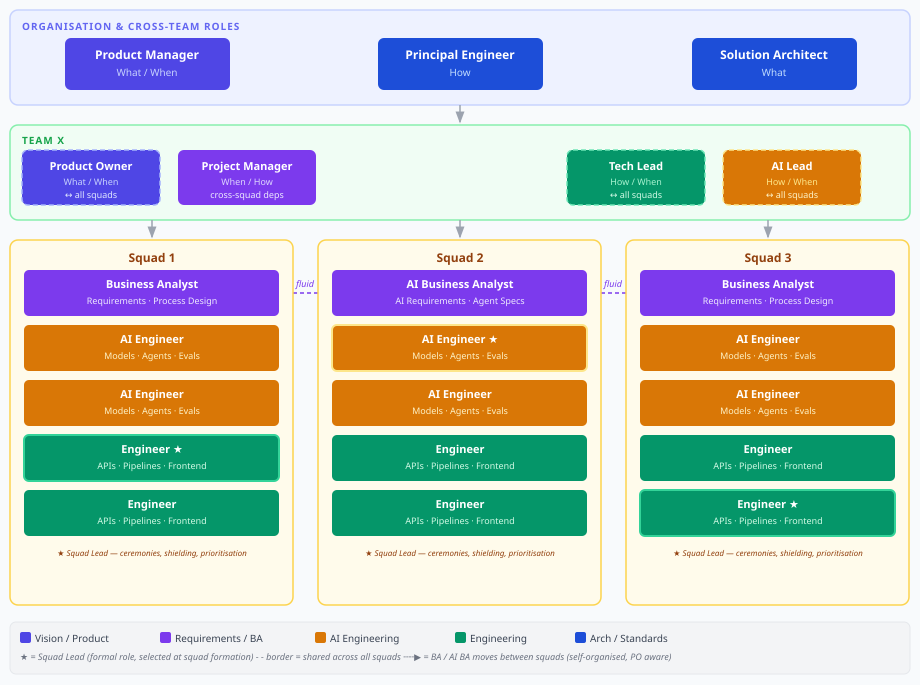

# agentme-bdr-article-001: Product team composition overview

## Overview

A visual overview of the simple and complex product team composition models. Intended for product owners, tech leads and engineering managers who are structuring or scaling a product team.

## Content

A team with a bounded product scope and limited AI surface works as a simple team with no internal squads. A team with a broad scope or significant AI surface works with internal squads. Shared leadership (Product Owner, Tech Lead, AI Lead and Engineering Manager) connects to every squad, and a Project Manager owns cross-squad dependencies.

The diagram gives a quick view of how the roles fit together. Role counts, squad rules and the known structural gaps are defined in the policy tables, which are the source of truth if the two ever differ.

## References

- [agentme-bdr-403](../403-product-team-composition.md) - Policy defining the composition models, squad structure, squad dynamics and known gaps
