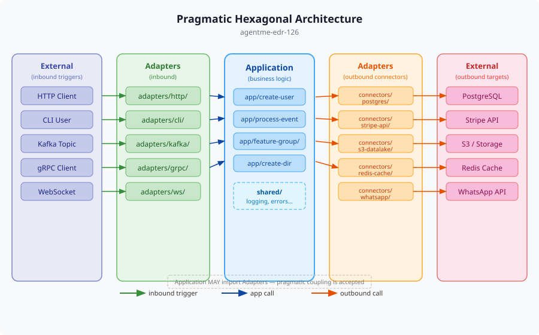

# agentme-edr-article-001: Pragmatic hexagonal architecture overview

## Overview

A visual overview of the three layers behind the pragmatic hexagonal architecture. Intended for engineers who organise application source code and want a quick picture before reading the policy.

## Content

Application code is organised into three conceptual layers. **External** systems sit outside the codebase boundary: databases, third-party APIs, message brokers, filesystems and users. **Adapters** translate between External systems and the Application, turning external protocols into application calls and back. The **Application** holds business logic and delegates its I/O to adapters.

The diagram shows the usual flow of requests and data between the layers. The policy also accepts pragmatic coupling where the Application imports from Adapters when that simplifies the design. The policy text is the source of truth for the layer rules, naming conventions and folder structure.

## References

- [agentme-edr-126](../126-pragmatic-hexagonal-architecture.md) - Policy defining the three layers, adapter naming conventions and folder structure
