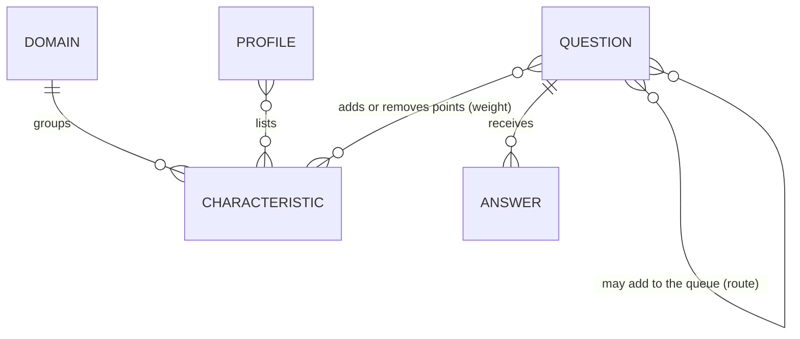

# exercise-adr-policy-201: Domain model

## Context and Problem Statement

The questionnaire needs one small, stable data model that every other policy and every implementation can rely on. Without it, scoring, routing and results drift apart.

Question: Which entities exist, what do they hold and how are they related?

## Decision Outcome

**Characteristic-centred model: Questions add or remove points on Characteristics, Characteristics belong to one Domain and to many Profiles, and Questions may route to other Questions.**

### Details

#### 01-entities-are-only-these-five

The model MUST contain only Domain, Characteristic, Profile, Question and Answer. Investigations, sessions-as-entities, response context and notes, instrument catalogues and question versions MUST NOT be modelled.

#### 02-domain-is-a-fixed-list

A Domain is a fixed identifier on a Characteristic, not a registry. The allowed values are `attention`, `executive_function`, `sensory_processing`, `social_communication`, `thinking_patterns`, `emotional_experience`, `interests_learning` and `adaptation_environment`. A new domain MUST be added by changing this rule and the schema together.

#### 03-characteristic-belongs-to-one-domain

A Characteristic MUST have exactly one Domain. A Characteristic MAY belong to many Profiles. Authoring fields are defined in `exercise-bdr-policy-605`.

#### 04-specializations-are-independent-characteristics

A specialization of a Characteristic (for example `repetitive_movement_motor_soothing` under `repetitive_movement`) MUST be a normal Characteristic. There MUST NOT be a parent link between Characteristics. A more specific Characteristic gives stronger evidence for a Profile simply by being listed in that Profile.

#### 05-profile-is-a-flat-list

A Profile MUST be a flat list of Characteristic ids. A Profile MUST NOT carry weights or rules of its own and MUST NOT carry thresholds, except the optional `margin_stop` that replaces `profile_margin_stop` for that Profile (`exercise-edr-policy-101.08-good-enough`). The profile weights used by `weighted_score` are derived from how many Profiles list each Characteristic (`exercise-edr-policy-101.10-weighted-profile-score`) and are not stored.

#### 06-question-fields

A Question MUST have `id`, `title`, `type`, `answer`, `characteristics`, `source`, and MAY have `details` and `routes`.
- `type` is one of `discovery`, `exploration`, `differentiation`, `balancing`.
- `answer` is `agreement` or `frequency` (scales in `exercise-bdr-policy-602`).
- `characteristics` is a non-empty list of `{id, weight}` with `weight` in -1..1 and not 0.
- `routes` is a list of `{when, threshold, add}` where `when` is `gte` or `lte` and `add` is a Question id.
- `source` is a plain text statement of where the question comes from.

#### 07-question-domain-is-derived

The Domain of a Question MUST be derived as the Domain of its Characteristic with the highest absolute weight. Ties MUST resolve to the first listed Characteristic. A Question MUST NOT store a domain field.

#### 08-answer-is-value-or-null

An Answer MUST hold a Question id and either a value (agreement -1..1, frequency 0..1) or null when the user skipped. Answers MUST be kept in the order they were given. All other state (scores, queue, stages) MUST be derivable from the ordered Answers plus the registries and the analysed Profiles of the session (`exercise-adr-policy-101.10-analysed-profiles`). The analysed Profiles are a list of Profile ids and the ordered changes made to them (added or removed), each with the number of Answers given when it happened; they are session input, not a new entity (`01-entities-are-only-these-five`).

## References

- [exercise-adr-policy-202 - Registries](202-registries.md)
- [exercise-adr-policy-101 - Question flow engine](../application/101-question-flow-engine.md)
- [exercise-edr-policy-101 - Measurement formulas](../../edrs/application/101-measurement-formulas.md)
- [exercise-bdr-policy-602 - Response scales](../../bdrs/product/602-response-scales.md)
- [exercise-bdr-policy-605 - Characteristic and profile authoring](../../bdrs/product/605-characteristic-and-profile-authoring.md)
